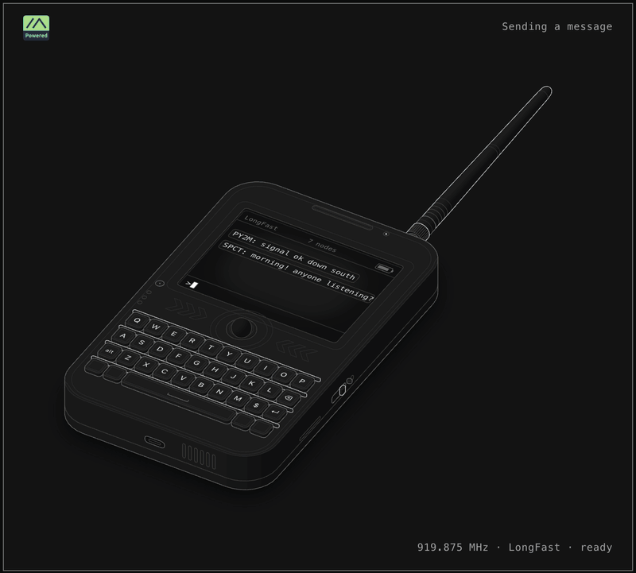

# meshbrasil-anatomy



**Try it:** [English](https://rogerio-richa.github.io/meshbrasil-anatomy/lora-handheld/lora-handheld.html) ·
[Português](https://rogerio-richa.github.io/meshbrasil-anatomy/lora-handheld/lora-handheld-pt.html)
([GIF em português](media/meshbrasil-anatomy-pt.gif))

How a Meshtastic message travels, as an interactive drawing: type on a handheld, watch the
packet go out as LoRa chirps, then follow it across a neighbourhood mesh, hop by hop.
Made by the [Meshtastic Brasil](https://www.meshbrasil.com) community. English and Brazilian Portuguese.

Each page is one HTML file (plain SVG and JavaScript, no framework, no network calls) plus the
logo in `assets/`, so it works offline and can be dropped into any site. An EN/PT switch sits
under the card.

## The three scenes

1. **Sending a message** - a handheld with a 35-key keyboard. Type and press Enter: the readout
   gives your text's size, the packet size and its LoRa time on air for the LongFast preset
   (SF11, 250 kHz, CR 4/5, 919.875 MHz, the ANZ slot used in Brazil), from the Semtech formula,
   and the antenna transmits for that long.
2. **Riding the waves** - the packet as a waterfall seen in perspective: 16 preamble up-chirps,
   the two sync-word chirps (0x2B), 2.25 down-chirps, then the header and payload symbols.
   Switch between clean lines and a heat map computed from the same chirps over a noise floor.
3. **Mesh at work** - a suburban street with nodes on the roofs. The message floods the way
   Meshtastic floods: each node waits before rebroadcasting (shorter when the signal was weak,
   so the edge of the mesh tends to go first), drops its rebroadcast if it hears another relay
   first, and each relay spends one of the 3 hops (hearing the sender directly is 0 hops, as
   Meshtastic counts them). The shop's node is CLIENT_MUTE: it listens but never forwards.

## What is simplified

- The data-chirp starting frequencies stand in for the real coded bits (no whitening,
  Hamming coding, interleaving or Gray mapping). The symbol *count* is real.
- The packet size is modelled: the 16-byte header plus the Data message (portnum, payload,
  bitfield). Real packets can differ by a few bytes (encryption, extra fields).
- In the suburb, distances are a stand-in for a few hundred metres, the range is a fixed
  circle (no terrain, walls or fading), distance stands in for SNR, the contention wait is
  deterministic (firmware picks a random slot in an SNR-sized window), and timings are slowed
  down to be watchable.

## Build

Needs Node 20 or newer, nothing else.

```sh
cd lora-handheld
node build.mjs                      # all four pages: en/pt-BR x dark/light
node build.mjs --lang pt --light    # just one
```

This writes `lora-handheld.html`, `lora-handheld-light.html`, `lora-handheld-pt.html` and
`lora-handheld-pt-light.html`. They load `assets/m-powered.svg`, so keep that folder next to
them. The `.html` files are generated: edit the sources and rebuild. `index.html` at the root
just points GitHub Pages at the English page.

## Layout

```
kit/                     the Anatomy drawing kit (vendored, MIT): isometric camera, solids, SVG
lora-handheld/
  build.mjs              assembles the pages
  model.mjs              packet size and LoRa time on air (Semtech AN1200.13), shared by build and page
  strings.mjs            every visible string, en and pt-BR
  style.css              the page's styles
  scenes/                geometry, run at build time (device, waterfall, suburb)
  client/                browser code, one file per scene, concatenated into the page
  assets/m-powered.svg   the Meshtastic "M-Powered" logo
```

Geometry is computed once at build time with the kit and written into the page as SVG; the
browser code only moves things (keys, rings, chirps, arcs) and updates the readout.
`client/*.js` share one scope: they read build data from `DATA`, text from `STR`, and the LoRa
helpers from `model.mjs`, which is inlined ahead of them.

## Contributing

Ideas that would make it better:

- A preset picker (ShortFast, MediumSlow, LongModerate...) driving the airtime and the chirps.
- Real LoRa symbol coding for the data chirps.
- More languages (add a block to `strings.mjs`; the EN/PT switch picks them up).
- New scenes: routing, channels and encryption, store and forward...

Keep the rule the drawing kit is built on: every number on screen comes from the same model
that moves the parts.

## Credits and license

- Code: MIT, see [LICENSE](LICENSE).
- [`kit/`](kit/) is the drawing kit from the [Anatomy](https://github.com/wheresryan22/anatomy)
  skill by Ryan (MIT, see `kit/LICENSE`).
- The "M-Powered" logo is from [meshtastic/design](https://github.com/meshtastic/design) (GPL-3.0),
  used unmodified as the guidelines allow; see `lora-handheld/assets/README.md`.

Meshtastic® is a registered trademark of Meshtastic LLC. This project is not affiliated with Meshtastic LLC.
